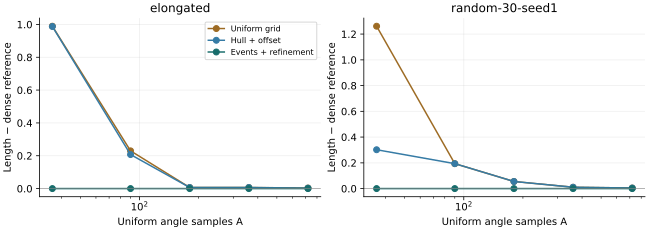
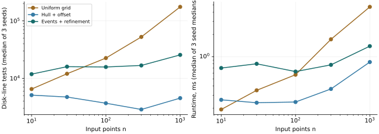
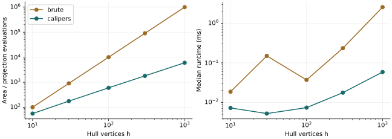

# Capturing a Shape with a Line Segment

Szymon Januszewski · Technical report · Version 1.0.0

## 1. Problem and scope

A capsule is the radius-r neighbourhood of a segment: a rectangle with two semicircular ends, or a disk when the segment has zero length. It provides a compact, directional bound for a point cloud. Given planar points P and a positive radius r, the problem is to find a shortest segment s satisfying:

```math
\min_s |s| \quad \mathrm{subject\ to}\quad d(p,s)\leq r\quad (p\in P).
```

The equivalent disk formulation is particularly useful: s must intersect every radius-r disk centred at an input point. There are three possible outcomes: no segment exists, a single point suffices, or a positive-length segment is required. The journal article by van Beusekom et al. [1] develops an exact algorithm in O(n log h + h log³ h), where h is the hull size. Its earlier EuroCG version [2] gives O(n log h + h²).

This implementation follows the geometric reductions in those papers, then uses numerical search. It implements a uniform reference grid, convex-hull reduction, a linear rotating-calipers width scan, numerical fixed-direction optimization, analytic support/feasibility events and local angular refinement. The full exact circular-arc sweep is studied below but is not implemented. There is no claimed global approximation ratio. The source, experiments and interactive explanations make these distinctions visible rather than hiding them behind a single result labelled optimal.

The scope is small planar datasets in ordinary floating-point coordinates. The browser editor supports 100 points in a 900 × 560 drawing. Separate Node.js experiments reach 1,000 points. All lengths use the input coordinate units; positive angles appear clockwise in the SVG coordinate system.

## 2. Geometric reductions

### 2.1 Why only hull vertices matter

The capsule is a Minkowski sum of a segment and a disk. Both are convex, so the capsule is convex. If all hull vertices lie inside it, every convex combination of those vertices also lies inside it. Thus it contains the whole convex hull and every original point. The converse is immediate because hull vertices are input points. This is the reduction in journal Lemma 1 [1].

The implementation uses Andrew's monotone chain, sorts lexicographically, removes duplicates and keeps only the endpoints of collinear runs. Its cost is O(n log n); it does not use the output-sensitive O(n log h) hull algorithm assumed in the published bound. The original points remain available for independent verification. For the standard convex-hull background and the sorted incremental scan, see de Berg et al. [3, Chapter 1].

### 2.2 Feasibility through minimum width

If a segment is feasible, its supporting line is within r of every point. Two parallel lines at distance r on either side enclose the input in a strip of width 2r. Conversely, the middle line of any such strip intersects every disk. Each intersection is a closed, bounded interval. A finite segment spanning the finitely many intervals meets them all. Therefore:

```math
\mathrm{feasible}\quad\Longleftrightarrow\quad w(P)\leq 2r.
```

A minimum-width strip of a convex polygon has a support parallel to an edge. For each oriented hull edge, the farthest vertex is its antipodal support. As the edge moves around the counterclockwise hull, this vertex only advances. The implementation evaluates cross-product area divided by edge length, retaining the narrowest strip and its direction. The pointer makes fewer than two circuits including initialization: O(h) total work. Empty, single-point and collinear hulls have zero width. A quadratic edge-by-vertex implementation is retained only as a test reference.

### 2.3 Zero length and a lower bound

Width feasibility is not a test for a point solution. Even diameter at most 2r is insufficient: an equilateral triangle of side 2r has circumradius 2r/√3, which exceeds r. A point solution exists exactly when the smallest enclosing-circle radius R is at most r.

All three methods share a shuffled incremental enclosing-circle check on the hull. Boundary updates use one point, a diameter pair, or a circumcircle of three points. A fixed shuffle seed ensures repeatability. Its worst-case cost is O(h³), and no expected linear-time guarantee is claimed for this fixed shuffle. Small independent exhaustive circle tests validate the implementation. The circle is used numerically, with final containment checks, rather than as an exact-arithmetic predicate.

A capsule around a segment of length L fits inside the disk centred at the segment midpoint with radius r + L/2. Thus the smallest enclosing-circle radius satisfies R ≤ r + L/2, giving:

```math
L^*\geq\max(0,2(R-r)).
```

This geometric lower bound can be weak, but it is independent of angular sampling. It is evaluated in floating point, so the displayed gap is not a formal interval-arithmetic certificate. For collinear extremes at distance D, it matches the exact answer max(0, D − 2r).

## 3. Solving a fixed direction

### 3.1 Disks become intervals

Let u = (cos θ, sin θ), v = (−sin θ, cos θ), and write each input point as (xᵢ, yᵢ) in this basis. A line has equation t u + b v. It meets every disk exactly when its offset lies in the following feasible strip:

```math
b\in[\max_i(y_i-r),\ \min_i(y_i+r)].
```

Within this strip, disk i intersects the line in an interval whose endpoints are:

```math
\ell_i(b)=x_i-\sqrt{r^2-(y_i-b)^2},\qquad q_i(b)=x_i+\sqrt{r^2-(y_i-b)^2}.
```

Define the extreme endpoints A and B. The shortest segment meeting all intervals has length:

```math
A(b)=\max_i\ell_i(b),\quad B(b)=\min_i q_i(b),\quad L(b)=\max(0,A(b)-B(b)).
```

If A > B, the segment [B, A] is necessary and sufficient: a solution must start at or before the smallest right endpoint B and end at or after the largest left endpoint A. Every interval intersects [B, A]. If A ≤ B, all intervals contain [A, B], and its midpoint is a valid zero-length answer. Each line evaluation costs O(h), or O(n) when hull reduction is disabled.

The interface displays these intervals with point labels. Gold marks the disks attaining the two extreme endpoints; additional disks can also be tight. At most 12 hull intervals are drawn, with the active constraints first. The solver still uses every constraint.

### 3.2 Convex numerical optimization

The left semicircle function ℓᵢ is convex on its domain; the right semicircle qᵢ is concave. Consequently A is convex, B is concave, and max(0, A − B) is convex on the feasible strip. Golden-section search can minimize it without differentiating at envelope corners or at flat minima.

The routine explicitly evaluates both strip endpoints, then contracts a bracket until its width is at most τ = 10⁻⁴ units, with a defensive limit of 96 iterations. It returns the best evaluated candidate and the final bracket width and convergence flag. A strip of zero width is handled directly by the same routine. Numerical cost is O(h(K + 1)), where K is the iteration count, usually O(log(2r/τ)).

The tolerance controls line position, not segment-length error. Near a tangency, a square-root derivative can be unbounded; therefore τ alone does not establish a uniform additive length guarantee. Angular sampling introduces another, separate approximation.

### 3.3 The exact O(h) construction in the paper

Journal §2.1 [1] constructs the relevant boundaries of the disk intersection envelopes on the feasible strip. Hull order is essential: circular arcs can be inserted in order while removing arcs that no longer contribute. A stack supports this process, with each arc inserted and removed at most once. Constructing the two boundaries therefore takes O(h), rather than testing every pair of circles.

Where the two active arcs are smooth, the distance between their boundary points along the prescribed direction is minimized when their tangents have the same slope. At a vertex, one-sided slopes replace a single derivative: a minimum occurs when the slope difference changes sign across the corner. Strip endpoints must also be considered. The ordered envelopes let the algorithm locate the appropriate arcs or vertices in linear total time. Lemmas 2–4 justify this fixed-direction construction.

The numerical routine implements the same convex objective but recomputes all intervals at each offset. It does not construct or maintain those arc stacks, and its extra logarithmic tolerance factor must not be confused with the exact O(h) bound.

## 4. Rotating the direction

### 4.1 What the exact sweep maintains

In journal §2.2, the two feasible-strip boundaries, the relevant circular-arc envelopes and the contact points of the shortest segment change as θ rotates. Between events, the combinatorial configuration is fixed, allowing the next event to be computed from the current arcs and supporting disks. The event categories below use the journal numbering; earlier versions differ.

| Type | Change tracked by the exact algorithm | Bound / processing |
| --- | --- | --- |
| 1a | Optimal segment reaches or leaves a strip boundary | O(h) events; O(1) each |
| 1b | Segment endpoint reaches or leaves an envelope vertex | O(h) events; O(1) each |
| 2a | A strip boundary tangent to an envelope passes an envelope vertex | O(h) events; O(log² h) each |
| 2b | A non-tangent strip boundary passes a prospective envelope vertex | O(h log h) including internal events; O(log² h) each |
| 3 | Strip boundaries coincide, changing feasibility | O(h) events; O(log² h) each |
| 4 | Supporting disk changes at a direction parallel to a hull edge | O(h) events; O(log² h) each |

Simultaneous events are handled in descending type order, 4, 3, 2, then 1. This avoids using an obsolete support configuration when a lower-type event is processed. The difficult part is anticipating envelope changes, including vertices not currently exposed on the active strip.

Journal §§2.3–2.4 [1] describe the range-query structure used to anticipate envelope changes. Section 2.4 first partitions the cyclic hull into maximal subsequences whose total turning angle is at most π/2 and whose first and last vertices are at distance at most r. These conditions ensure a non-empty common intersection of the radius-r disks in each subsequence. A balanced binary tree is built for each subsequence; each node stores the ordered boundary arcs of the intersection of its descendant disks. The complete structure is a collection of these trees, occupying O(h log h) space.

The relevant queries are restricted to ranges of diameter at most 2r and visit only O(1) of these subsequences. Within a tree, a contiguous range decomposes into O(log h) canonical subtrees, with an O(log h) boundary search in each. This gives O(log² h) query time for the required circular-ray or line intersections. The partition and query restrictions matter: a single unrestricted tree over all hull vertices could have empty disk intersections. These queries expose the next relevant intersection without reconstructing a full envelope after every event.

The dominant type-2b family contributes O(h log h) events at O(log² h) each; the other types fit within this bound. Including the output-sensitive hull construction yields O(n log h + h log³ h), journal Theorem 5. The O(h²) sweep term in the shorter EuroCG article is an earlier result, not the bound of the final journal data structure. This implementation includes neither that range-query structure nor the full type-1/type-2 event scheduler.

### 4.2 Implemented support and feasibility events

Support changes occur at hull-edge directions modulo π. Sorting these directions partitions [0, π] into sectors. Inside a sector the minimum and maximum projections onto v are attained by fixed vertices. Their indices advance monotonically across sectors. If their displacement is (dx, dy), the width is:

```math
w(\theta)=dy\cos\theta-dx\sin\theta.
```

The code solves w(θ) = 2r analytically within each sector using a phase shift and arccosine. Roots are clipped to the sector, merged with equal-angle support events, and used to construct closed feasible angular intervals. A singleton interval is retained when only the tangent orientation is feasible. Sorting costs O(h log h); the subsequent support traversal and root enumeration take O(h).

These are events of types 3 and 4 in the journal's terminology, not the complete set needed for exact optimization. They ensure that each detected feasible angular component contributes candidates even when it is narrower than a uniform sample gap. They do not identify every local extremum of optimal segment length.

### 4.3 Three implemented searches

The baseline tests A uniformly spaced angles and B uniformly spaced offsets per feasible strip, using all original points. The second method uses hull vertices, numerical offset minimization and the same angle grid plus the minimum-width direction. That extra direction is a feasibility witness; it prevents a complete angular miss when the width test succeeds, subject to numerical checks.

The third method starts with every candidate direction of the second. It adds support events, feasibility events, and the endpoints and midpoint of each feasible component. At each refinement round, the four shortest sampled candidates are selected; midpoints between each candidate and its angular neighbours are evaluated, with wraparound modulo π. Existing candidates are retained. This improves or preserves the incumbent but can miss a better basin elsewhere.

```text
hull, width := preprocess(points)
if width > 2r: return infeasible
if enclosing circle fits in radius r: return point
evaluate uniform directions and minimum-width direction
evaluate support events, width roots and feasible-component midpoints
repeat R rounds:
    take the four shortest feasible sampled candidates
    evaluate midpoint directions to their neighbours
verify the best segment against every original point
```

Let C(h) be the enclosing-circle cost, K the numerical offset iteration count, and M the total number of directions. M is O(A + h + R), because each round adds at most eight directions. The implementations have these upper bounds, including final verification:

| Method | Time bound |
| --- | --- |
| Uniform grid | O(n log n + C(h) + ABn) |
| Hull + optimized offset | O(n log n + C(h) + (A + 1)h(K + 1)) |
| Events + local refinement | O(n log n + C(h) + h log h + Mh(K + 1) + RM log M) |

The last term includes sorting the sampled directions and promising candidates each round in this straightforward implementation. Auxiliary memory is O(n + M). C(h) has worst case O(h³) here. These are actual implementation bounds, not the article's complexity. A scan count in the UI counts disk–line tests only; it excludes hull construction, the circle, events, width computation and final distance verification.

## 5. Validation and numerical limits

Every returned global candidate is independently checked against every original point. The distance routine clamps the orthogonal projection parameter to [0, 1] and measures distance to the resulting segment point; it does not reuse disk-intersection formulas. A failed check hides the candidate and reports a numerical failure. Fixed-direction candidates displayed in the browser receive the same check.

The 27 automated tests cover analytic lengths, empty/single/collinear/duplicate inputs, tangent strips, infeasible data, rotation and translation, random instances, JSON validation and capsule–disk overlap. The calipers scan is compared with the quadratic width scan on 80 seeded hulls and a regular 1,000-gon. The circle is compared with exhaustive one-, two- and three-point candidate circles on 100 small seeded sets. Event intervals are checked against direct projection at 36,000 sampled angles, including separate seam and isolated-tangency tests. Monotone improvement with refinement, hull ablation and a deliberately missed uniform grid are also tested.

These tests are evidence, not exact-predicate guarantees. Coordinates use JavaScript double precision, and the hull uses an ordinary cross product. Extremely large magnitudes, extreme aspect ratios or nearly collinear triples can cause cancellation. The distance/width tolerance is ε = 10⁻⁷ units. Tiny negative radicands caused by accepted roundoff are clamped to zero. Circle containment uses a scale-aware machine-precision allowance, followed by the common final distance check. Event angles within 10⁻¹² radians are merged. These tolerances can change decisions inside their uncertainty band.

The examples include an equilateral triangle demonstrating that diameter ≤ 2r does not imply a point solution, and another triangle exactly on a radius-r circle. Width-boundary experiments use perturbations of ±10⁻⁴, larger than the acceptance tolerance. Floating-point feasibility and the enclosing-circle lower bound should therefore be read at the stated precision, not as symbolic proofs.

## 6. Reproducible experiments

### 6.1 Protocol

{{environment}}

Each timed measurement is the median of five complete solver calls after one warm-up. Timings include preprocessing and verification. They are measurements on one machine without isolation from other processes; sub-millisecond differences are especially noisy. The operation counts are deterministic for the recorded inputs. Random data uses the LCG in the shared examples module, with seeds 1–5 for quality and 1–3 for scaling and ablation.

The default settings are A = 180, B = 25, six refinement rounds and τ = 10⁻⁴. Quality is compared with a denser event-assisted numerical search at 4,096 angles, 12 rounds and τ = 10⁻⁷. This reference is another feasible candidate, not an exact oracle. Signed differences can be negative because the grids and numerical stopping paths differ. An additional independent offset grid uses 1,440 angles × 401 offsets on three small cases. It avoids golden-section minimization but still samples directions.

The recorded suite has 63 quality rows on 21 instances, 60 scaling rows, 30 hull-ablation rows, 10 width-scan rows, 45 angular-resolution rows, 18 offset-tolerance rows and three dense-grid comparisons. The quality inputs are stored in JSON; all rows and environment metadata are included in docs/experiments. The browser limit does not apply to the Node.js benchmark.

### 6.2 Candidate quality

{{quality_table}}

{{quality_findings}}

The narrow rotated rectangle is particularly instructive. Its width is 32 and r = 16.01; the feasible angular component is much narrower than a one-degree grid spacing. The baseline reports a sample miss. Both improved methods use the minimum-width witness, and the event method additionally identifies the narrow component's boundaries. This demonstrates why a failed grid must not be labelled infeasible.



The collinear instance has exact length 520 − 2 × 45 = 430 and is recovered to roundoff. The point-threshold instance returns zero independently of the angle grid. Positive-length candidates generally improve with finer sampling, but different uniform grids are not nested, so arbitrary increases in A need not produce monotone improvements. Refinement of a fixed initial grid is monotone because candidates are retained.

### 6.3 Cost and ablation



{{ablation_findings}}

This ablation uses identical angle choices, offset tolerance and point detection, changing only whether the fixed-direction solver scans the hull or all points. It therefore isolates hull reduction more clearly than comparing the full grid and event methods. For regular polygons all input points are hull vertices, so this advantage disappears. These cases are also close to the enclosing-circle threshold and have many narrow feasible angular components; they should not be interpreted as generic random-data scaling.

The event method usually performs more work than the simple hull method because it evaluates additional directions. Its purpose is better angular coverage and candidate quality, not a universal speed-up. On small hulls, numerical offset optimization can also use more interval evaluations than a grid with only 25 offsets.



{{width_findings}}

### 6.4 Precision checks and reference limits

{{precision_findings}}

The dense-grid comparison and independent point-to-segment validation address different failure modes: the former checks search quality against another sampling strategy, while the latter checks whether the returned geometry satisfies the constraints. Neither alone proves global optimality. The denser reference shares primitives with the event solver, so the analytic cases, exhaustive circle oracle and separate width scan remain necessary complementary checks.

## 7. Interactive demonstration and use

The page lets the reader add, drag, delete and label points, adjust the radius, and compare the three candidate capsules. Keyboard controls permit point selection and movement. Import/export of versioned JSON preserves coordinates, radius and search settings. SVG export saves the current drawing. All processing stays in the browser; there is no backend or external runtime dependency.

For a fixed angle, the page shows the feasible strip, allows manual line placement, and plots the convex length function. The orientation plot shows evaluated candidates, feasible angular components and the implemented support/feasibility events. Its connecting lines are visual interpolation, not evaluations between samples. The rotation animation retains the shortest segment encountered in blue; it is a visualization at one-degree increments, separate from the global method results in the comparison table.

The optional collision panel tests a probe disk of radius ρ against the capsule. Overlap occurs when the probe centre is at distance at most r + ρ from the representative segment. Separation certifies separation from the contained point set; overlap is only a conservative broad-phase indication and can be a false positive for the original geometry. Zero-length segments reduce naturally to disk–disk overlap.

To reproduce the work, serve the repository root with Python's HTTP server and open index.html. Node.js 18 or newer runs the tests and experiments without installing packages. Figure and report regeneration use optional Python plotting/Markdown packages and pdfLaTeX; the generated HTML, SVG and PDF are already included for readers who only want to run the demo. The README gives the exact commands and source-archive instructions.

## 8. Conclusions and further work

The geometric reductions produce a small, inspectable solver: feasibility is separated from search failure, hull constraints replace redundant interior points, and fixed-direction minimization follows from convexity. Selected analytic events resolve an important weakness of uniform sampling by exposing narrow feasible angular components. The experiments show the cost of extra angular exploration alongside improvements in candidate quality, rather than treating all optimizations as automatic speed-ups.

The main remaining algorithmic step is the exact circular-arc sweep, including type-1/type-2 events and the journal's range-query data structure. A separate numerical improvement would be adaptive refinement with certified interval bounds, rather than selecting only four promising samples. Robust orientation predicates and certified circle/angle computations would be needed for guarantees outside the current floating-point scope. These extensions are deliberately distinguished from the working numerical implementation.

## 9. Contributions and AI use

This is an individual project by **Szymon Januszewski**. I wrote the majority of the code and an initial, summarized documentation. I used **OpenAI Codex** to help identify and correct errors in the code, improve its clarity, and document it more thoroughly. Codex also expanded and structured the documentation from my initial draft. I remain responsible for the submitted project and its explanation; the underlying published geometric results are attributed to their authors in the references.

The [public source repository](https://github.com/Szym0n96/capturing-shape-with-a-line-segment) contains the code, tests, report source and recorded experiments. The [project webpage](https://szym0n96.github.io/capturing-shape-with-a-line-segment/) provides the demonstration and this report.

## References

1. N. van Beusekom, M. van Kreveld, M. van Mulken, M. Roeloffzen, B. Speckmann and J. Wulms. **Capturing the Shape of a Point Set With a Line Segment.** Computing in Geometry and Topology, 4(1), Article 10, pp. 10:1–10:35, 2025. [doi:10.57717/cgt.v4i1.74](https://doi.org/10.57717/cgt.v4i1.74). Sections 2–2.4 and Theorem 5 are the basis for the exact-algorithm discussion.

2. N. van Beusekom, M. van Kreveld, M. van Mulken, M. Roeloffzen, B. Speckmann and J. Wulms. **Capturing the Shape of a Point Set with a Line Segment.** 40th European Workshop on Computational Geometry (EuroCG 2024), Ioannina, Greece, 13–15 March 2024, extended abstract, pp. 38:1–38:8. This version gives the earlier quadratic sweep bound. [Workshop PDF](https://eurocg2024.math.uoi.gr/data/uploads/paper_38.pdf).

3. M. de Berg, O. Cheong, M. van Kreveld and M. Overmars. **Computational Geometry: Algorithms and Applications.** 3rd edition, Springer, 2008. Chapter 1 provides the convex-hull background. [doi:10.1007/978-3-540-77974-2](https://doi.org/10.1007/978-3-540-77974-2).
